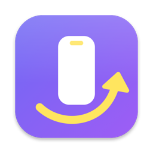
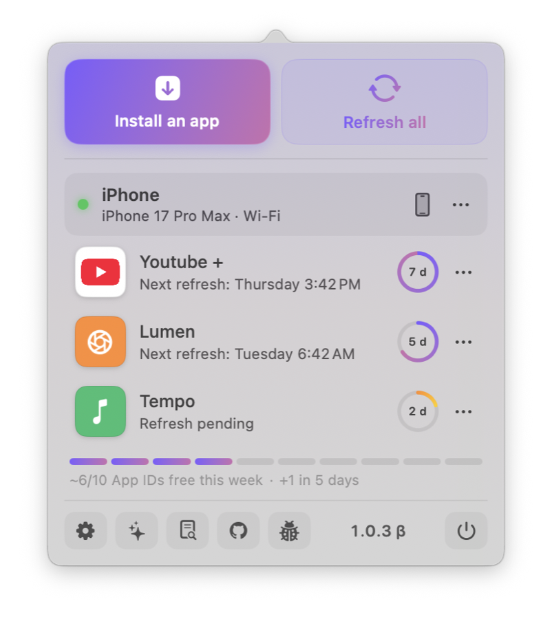
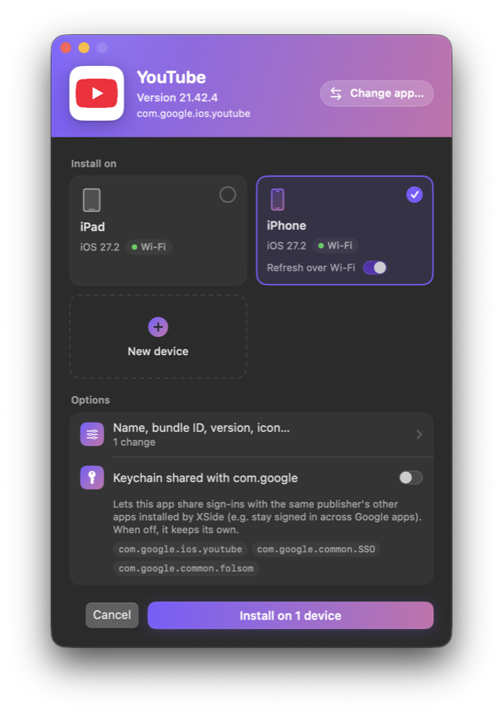
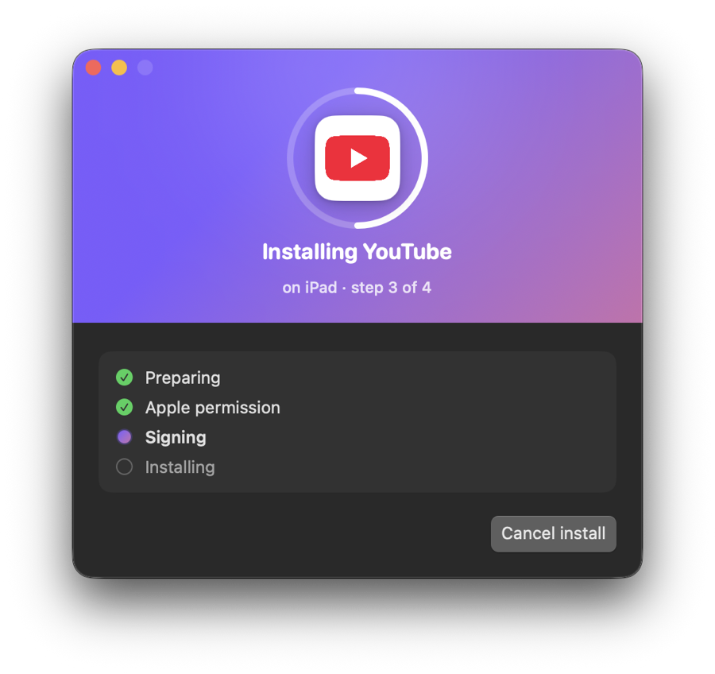
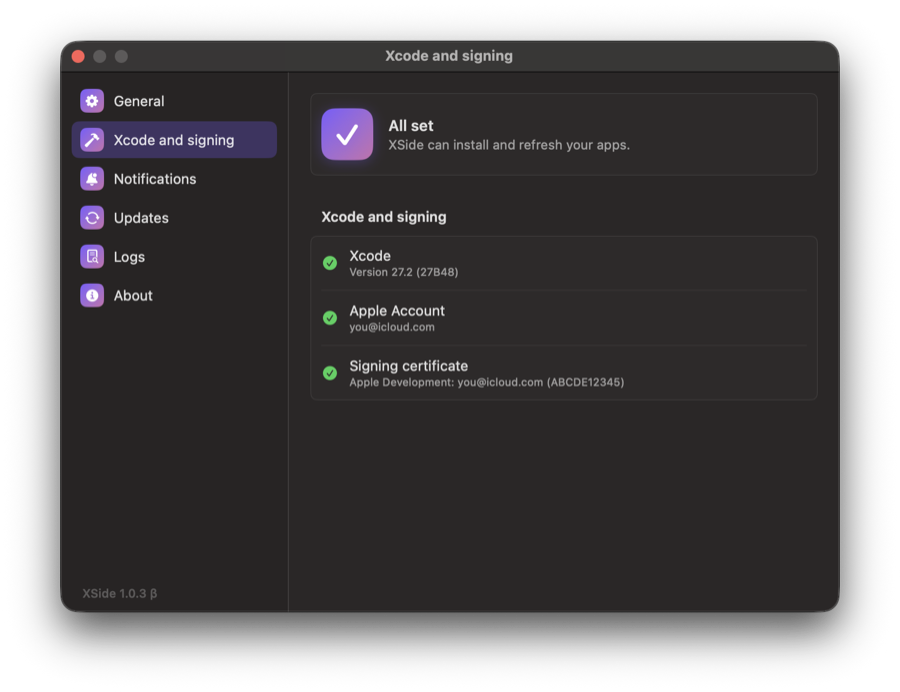
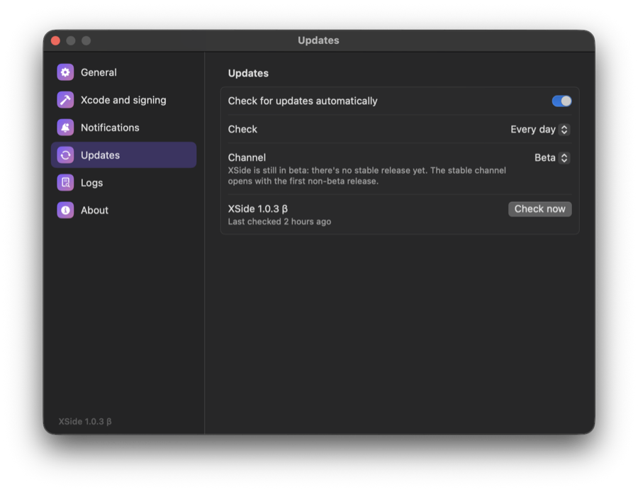
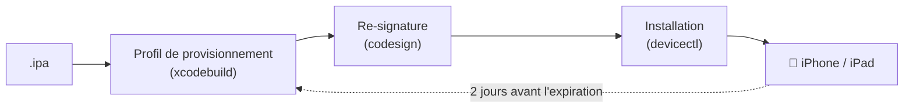

<div align="center">



# XSide

**Installe des apps iOS depuis la barre des menus de ton Mac, sans jamais les laisser expirer.**

Compte Apple gratuit · Outils officiels d'Xcode · Rafraîchissement auto en USB ou en Wi-Fi

[](#-prérequis)
[](https://swift.org)
[](https://developer.apple.com/xcode/)
[](LICENSE)
[](https://github.com/Antholife/xside/releases)
[](#-les-limites-dapple-avec-un-compte-gratuit)

[English](README.md) · **Français**

</div>

---

XSide installe des fichiers `.ipa` sur ton iPhone et ton iPad avec un compte Apple gratuit, puis les re-signe et les réinstalle avant l'expiration des 7 jours imposée par Apple, discrètement, depuis la barre des menus.

> [!WARNING]
> **XSide est en bêta.** C'est une préversion : il peut encore y avoir des bugs (même s'il tient très bien la route jusqu'ici), et toutes les fonctionnalités prévues ne sont pas encore là. Un souci ? [Ouvre une issue](https://github.com/Antholife/xside/issues).

> [!NOTE]
> XSide ne demande jamais ton mot de passe Apple. La signature passe par le compte que tu as déjà ajouté dans Xcode, avec les outils d'Xcode : `xcodebuild`, `codesign` et `devicectl`.

<p align="center">
  <picture>
    <source media="(prefers-color-scheme: dark)" srcset="docs/assets/screenshots/panel-dark.png">
    
  </picture>
</p>

<p align="center">
  
  
</p>

<p align="center">
  
  
</p>

## ✨ Fonctionnalités

| | |
|---|---|
| 📥 **Glisser pour installer** | Glisse un `.ipa` sur l'icône de la barre des menus, ou choisis-le, et installe-le sur un ou plusieurs appareils. |
| ✅ **Vérifications avant installation** | iOS trop ancien pour l'app, appareil qui a déjà ses 3 apps (désinstalles-en une sur place), plus d'App ID : tu le sais avant. |
| 🔄 **Rafraîchissement auto** | Les apps sont rafraîchies avant leur expiration (1, 2 ou 3 jours, au choix), en USB ou en Wi-Fi (par appareil), ou toutes d'un coup avec *Tout rafraîchir*. Pause, seulement sur secteur, la nuit ou le soir : une app sur le point d'expirer est toujours rafraîchie. |
| 🏷️ **Le module XSide dans tes apps** | Chaque app dit d'où elle vient et jusqu'à quand elle marche : une fenêtre après l'installation, une barre à l'ouverture (« Valable encore 5 jours », orange ou rouge si XSide n'a pas pu la rafraîchir à temps), une carte après un rafraîchissement, un rappel la veille de l'expiration, et une page *Réglages XSide* : appui long sur l'icône de l'app > *Réglages XSide*, ou *Réglages > Apps > [nom de l'app] > Réglages XSide*. |
| 🎚️ **Des réglages qui te suivent** | Chaque app a ses réglages XSide par appareil (barre de validité, alerte de retard, carte, rappel, langue, rafraîchissement automatique), modifiables sur l'iPhone ou sur le Mac et synchronisés : le changement le plus récent l'emporte. Sur le Mac, *Réglages > Mes apps* montre les réglages de chaque app et où en est chaque changement, appareil par appareil. |
| 👆 **Rafraîchir depuis l'iPhone** | Appui long sur l'icône d'une app : *Réglages XSide*, *Rafraîchir maintenant*, *Signaler un problème*. XSide répond à ses apps sur le réseau local (signé, propre à chaque app) ; désactiver *Rafraîchissement automatique* dans les Réglages iOS de l'app le met en pause. macOS peut demander une fois d'autoriser les connexions entrantes. |
| 🪜 **Une installation guidée** | Quatre étapes (Appareils, Installation, Tweaks, Module XSide dans l'app), chaque option expliquée avec un aperçu et l'endroit où la changer ensuite. *Revoir les options à chaque installation* peut être désactivé pour les apps déjà installées. |
| 🧰 **Des tweaks, sans jailbreak** | Ajoute des tweaks (`.deb`, `.dylib`, `.framework`, `.bundle`) dans l'étape *Tweaks* de la fenêtre d'installation, par appareil. XSide vérifie chacun et dit pourquoi quand il ne peut pas marcher : ✅ compatible tel quel, 🔧 converti (Substrate, Substitute ou libhooker remplacé par ElleKit, les dossiers du jailbreak redirigés dans l'app, Cephei intégré, libroot intégré au tweak ; tu confirmes d'abord), ❌ pas compatible (il demande un jailbreak, ou il est fait pour une autre app…). Les tweaks sont gardés à chaque rafraîchissement. **Limites, testées sur un iPhone Duo sous iOS 27.3 :** les hooks Objective-C marchent ; **les hooks de fonctions C non (iOS tue l'app)**, et XSide les signale et nomme le tweak en cas de plantage ; la page de réglages d'un tweak n'est pas convertie ; les tweaks système (SpringBoard…) demandent un jailbreak. Un plantage dans un tweak est nommé, avec *Désactiver ce tweak* / *Désactiver les tweaks convertis*. |
| 🔗 **Dépendances des tweaks** | Chacune est listée comme fournie par XSide, ajoutée par toi, ou manquante (où la trouver, recherche, *Ajouter son .deb…*). *Télécharger* n'existe que pour une dépendance avec une source de confiance, après ta confirmation, en HTTPS et vérifié avec les empreintes du dépôt (aujourd'hui : Cephei sur Chariz, que XSide fournit déjà ; AltList n'est pas téléchargeable). *Réglages > Mes apps > Dépendances téléchargées…* liste ce qui a été gardé. ElleKit (BSD-3), Cephei (Apache-2.0, modifié) et zstd (BSD) sont compilés depuis leurs sources ; licences dans *À propos > Licences tierces*. |
| 🧩 **Installer telle quelle** | Pour une app qui refuse de se lancer parce qu'elle détecte une modification : installe-la sans les fonctionnalités XSide, app par app ou pour toutes. XSide continue de la rafraîchir. |
| ☁️ **Apps qui utilisent iCloud** | XSide ne donne pas iCloud aux apps (et un compte gratuit ne le peut pas), et ces apps plantent souvent. *Simuler iCloud déconnecté* (par appareil) lui fait croire qu'aucun compte iCloud n'est connecté : CloudKit, Core Data et SwiftData avec iCloud, CKSyncEngine, les réglages synchronisés par iCloud (gardés sur l'appareil) et iCloud Drive (vu comme indisponible). Les données restent sur l'appareil, rien n'est synchronisé ; une app qui exige iCloud pour fonctionner démarre en général, mais peut rester sur son écran de connexion. |
| 📱 **iPhone Duo** | *Ajouter la compatibilité iPhone Duo* (par appareil, dans les *Correctifs de compatibilité* de l'installation) permet à une app conçue avant l'iPhone Duo d'en utiliser tous les écrans, intérieur et extérieur, en mode Duo. Une app qui n'a jamais été prévue pour les scènes iOS reçoit un petit module de compatibilité XSide pour l'adapter ; l'affichage et certains comportements (liens, actions rapides) peuvent être imparfaits. |
| 🛡️ **Faire confiance en un geste** | Après l'installation, XSide ouvre l'app sur l'appareil ; s'il ne fait pas encore confiance au développeur, la bonne page des Réglages s'ouvre directement. |
| 🗑️ **Supprimée, c'est supprimée** | Une app supprimée de l'appareil disparaît de la liste d'XSide, sans jamais être réinstallée. |
| 🔔 **Aucune expiration ratée** | Rappels, pastille sur l'icône de la barre des menus, et notifications avec les boutons *Rafraîchir maintenant* et *Ouvrir XSide*. |
| 📱 **D'un coup d'œil** | Un panneau sous l'icône de la barre des menus : l'icône de chaque app, ses appareils, les jours restants, et les App ID de la semaine en frise. |
| 📊 **Vraie progression** | Des pourcentages pendant la signature, le temps écoulé pendant l'envoi sur l'appareil, et le pourcentage sur l'icône du Dock. |
| 🎛️ **Contrôle par app** | Rafraîchir maintenant, mettre en pause ou désinstaller de l'appareil. |
| ⬆️ **Se met à jour tout seul** | Les nouvelles versions arrivent automatiquement (Sparkle, signées) ; choisis la fréquence et le canal. |
| 🧭 **Configuration guidée** | Un parcours au premier lancement : Xcode, Apple Account, certificat de signature, notifications, appareils. |
| 🐞 **Signaler un bug facilement** | *Signaler un problème* ouvre le formulaire GitHub déjà rempli, et enregistre le journal complet sur ton Bureau pour le joindre. Tes infos personnelles sont masquées. |
| 🌍 **Traduit** | Français et anglais. |

## ⚙️ Comment ça marche



## 📋 Prérequis

- Un Mac sous **macOS 15 ou plus récent**.
- **Xcode**, installé dans `/Applications` et ouvert une fois.
- Un **compte Apple** ajouté dans *Xcode > Settings > Apple Accounts* (Réglages > Comptes Apple). Un compte gratuit suffit.
- Le **mode développeur** activé sur l'appareil, et l'appareil appairé une fois au Mac en USB.

> [!TIP]
> Si ton iPhone est sous une bêta d'iOS, il te faut la bêta d'Xcode correspondante, sur [developer.apple.com/download/applications](https://developer.apple.com/download/applications/).

Windows et Linux ne sont pas pris en charge : XSide repose sur Xcode, qui ne tourne que sur macOS.

## 🍎 Les limites d'Apple avec un compte gratuit

| Limite | Ce que ça veut dire |
|---|---|
| ⏳ **7 jours** | Les apps expirent au bout d'une semaine. XSide les rafraîchit avant, tant qu'il tourne dans la barre des menus. |
| 📱 **3 apps** | 3 apps installées ainsi au maximum par appareil. |
| 🆔 **10 App ID / 7 jours** | XSide affiche une estimation de ce qu'il reste : Apple ne donne pas le vrai chiffre. |
| 🧩 **Pas d'extensions** | Les widgets, extensions de partage et apps Watch sont retirés avant la signature. |

## 🚀 Installation

1. Télécharge `XSide-<version>.zip` depuis la [dernière release](https://github.com/Antholife/xside/releases).
2. Décompresse-le, mets `XSide.app` dans `/Applications` et ouvre-la.

Fonctionne sur les Mac Apple Silicon et Intel. Pour la compiler toi-même :

```sh
git clone https://github.com/Antholife/xside.git
cd xside
scripts/bundle.sh   # crée build/XSide.app
```

> [!IMPORTANT]
> L'app n'est pas notarisée. Si macOS la bloque, va dans **Réglages Système > Confidentialité et sécurité** et clique sur **Ouvrir quand même**.

Laisse XSide tourner dans la barre des menus (active *Lancer à l'ouverture de session* dans ses réglages) : c'est lui qui rafraîchit tes apps. XSide se met ensuite à jour tout seul (Sparkle), depuis *Réglages > Mises à jour*.

## ⌨️ En ligne de commande

Active-le dans *Réglages > Général > Outil en ligne de commande*, puis :

```sh
xside status                     # apps, appareils et jours restants (--json aussi)
xside refresh youtube            # rafraîchir une app maintenant (nom ou identifiant, partiel accepté)
xside refresh --all              # toutes celles qui peuvent l'être
xside pause 2h                   # met en pause les rafraîchissements auto (2h, 30m, 1d ; rien : jusqu'à reprise)
xside resume                     # les reprend
xside apps                       # les apps installées par XSide et leurs appareils (--json aussi)
xside devices                    # les appareils et leurs apps (--json aussi)
xside settings youtube           # les réglages du module XSide d'une app (--device, --json)
xside settings youtube reminder=off level=essentials
                                 # les changer, comme dans Réglages > Mes apps (showValidity, alertLate,
                                 # refreshCard, reminder, autoRefresh : on|off ; language=auto|fr|en ;
                                 # level=all|essentials|none) ; --device pour un seul appareil
xside pause youtube 1d           # mettre une app en pause (2h, 30m, 1d ; rien : jusqu'à reprise) ; --device aussi
xside resume youtube             # la reprendre
xside uninstall youtube          # la supprimer de ses appareils (demande d'abord ; --yes pour passer ; --device)
xside install ~/Downloads/a.ipa  # l'ouvrir dans la fenêtre d'installation
xside logs -f                    # le journal d'XSide (-f : le suivre)
xside report                     # écrire l'archive des journaux pour un signalement, afficher son chemin
```

Une app se nomme par son nom ou son identifiant, sans souci de casse ; une partie suffit quand une seule app correspond (sinon `xside` liste les candidates).

Si XSide n'est pas lancé, `xside` le démarre d'abord en arrière-plan. C'est toujours XSide qui signe, donc les deux ne signent jamais en même temps.

## 🛠️ Développement

```sh
swift build                      # compiler
swift test                       # tests de la logique (Sources/XSideCore)
CONFIG=debug scripts/bundle.sh   # build/XSide-debug.app, une app séparée avec ses propres données
scripts/check-strings.sh         # les textes français et anglais correspondent
```

## 📝 Historique des versions

Voir [CHANGELOG.md](CHANGELOG.md) pour ce qui change à chaque version (en anglais).

## 📄 Licence

[MIT](LICENSE) · Fait par [Antholife](https://github.com/Antholife)
