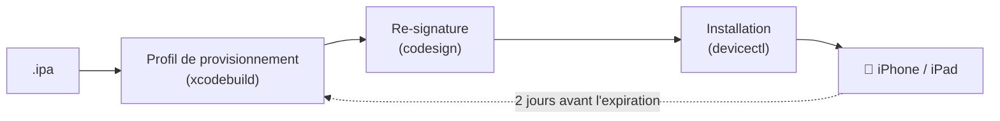

<div align="center">


# XSide

**Installe des apps iOS depuis la barre des menus de ton Mac, sans jamais les laisser expirer.**

Compte Apple gratuit · Outils officiels d'Xcode · Rafraîchissement auto en USB ou en Wi-Fi

[](#-prérequis)
[](https://swift.org)
[](https://developer.apple.com/xcode/)
[](LICENSE)
[](https://github.com/Antholife/xside/releases)
[](#-les-limites-dapple-avec-un-compte-gratuit)

[English](README.md) · **Français**

</div>

---

XSide installe des fichiers `.ipa` sur ton iPhone et ton iPad avec un compte Apple gratuit, puis les re-signe et les réinstalle avant l'expiration des 7 jours imposée par Apple, discrètement, depuis la barre des menus.

> [!WARNING]
> **XSide est en bêta.** C'est une préversion : il peut encore y avoir des bugs (même s'il tient très bien la route jusqu'ici), et toutes les fonctionnalités prévues ne sont pas encore là. Un souci ? [Ouvre une issue](https://github.com/Antholife/xside/issues).

> [!NOTE]
> XSide ne demande jamais ton mot de passe Apple. La signature passe par le compte que tu as déjà ajouté dans Xcode, avec les outils d'Xcode : `xcodebuild`, `codesign` et `devicectl`.

## ✨ Fonctionnalités

| | |
|---|---|
| 📥 **Glisser pour installer** | Glisse un `.ipa` sur l'icône de la barre des menus, ou choisis-le, et installe-le sur un ou plusieurs appareils. |
| 🔄 **Rafraîchissement auto** | Les apps sont rafraîchies 2 jours avant leur expiration, en USB ou en Wi-Fi (au choix, par appareil). |
| 🔔 **Aucune expiration ratée** | Rappels, pastille sur l'icône quand il faut agir, et notifications qui ouvrent le bon endroit pour corriger. |
| 🎛️ **Contrôle par app** | Rafraîchir maintenant, mettre en pause ou désinstaller de l'appareil. |
| 📱 **D'un coup d'œil** | L'icône de chaque app, ses appareils et les jours restants, directement dans la popup. |
| 🧭 **Configuration guidée** | Un parcours au premier lancement : Xcode, Apple Account, certificat de signature, notifications, appareils. |
| 🌍 **Traduit** | Français et anglais. |

## ⚙️ Comment ça marche



## 📋 Prérequis

- Un Mac sous **macOS 15 ou plus récent**.
- **Xcode**, installé dans `/Applications` et ouvert une fois.
- Un **compte Apple** ajouté dans *Xcode > Settings > Apple Accounts* (Réglages > Comptes Apple). Un compte gratuit suffit.
- Le **mode développeur** activé sur l'appareil, et l'appareil appairé une fois au Mac en USB.

> [!TIP]
> Si ton iPhone est sous une bêta d'iOS, il te faut la bêta d'Xcode correspondante, sur [developer.apple.com/download/applications](https://developer.apple.com/download/applications/).

Windows et Linux ne sont pas pris en charge : XSide repose sur Xcode, qui ne tourne que sur macOS.

## 🍎 Les limites d'Apple avec un compte gratuit

| Limite | Ce que ça veut dire |
|---|---|
| ⏳ **7 jours** | Les apps expirent au bout d'une semaine. XSide les rafraîchit avant, tant qu'il tourne dans la barre des menus. |
| 📱 **3 apps** | 3 apps installées ainsi au maximum par appareil. |
| 🆔 **10 App ID / 7 jours** | XSide affiche une estimation de ce qu'il reste : Apple ne donne pas le vrai chiffre. |
| 🧩 **Pas d'extensions** | Les widgets, extensions de partage et apps Watch sont retirés avant la signature. |

## 🚀 Installation

1. Télécharge `XSide-<version>.zip` depuis la [dernière release](https://github.com/Antholife/xside/releases).
2. Décompresse-le, mets `XSide.app` dans `/Applications` et ouvre-la.

Fonctionne sur les Mac Apple Silicon et Intel. Pour la compiler toi-même :

```sh
git clone https://github.com/Antholife/xside.git
cd xside
scripts/bundle.sh   # crée build/XSide.app
```

> [!IMPORTANT]
> L'app n'est pas notarisée. Si macOS la bloque, va dans **Réglages Système > Confidentialité et sécurité** et clique sur **Ouvrir quand même**.

Laisse XSide tourner dans la barre des menus (active *Lancer à l'ouverture de session* dans ses réglages) : c'est lui qui rafraîchit tes apps.

## 🛠️ Développement

```sh
swift build                      # compiler
swift test                       # tests de la logique (Sources/XSideCore)
CONFIG=debug scripts/bundle.sh   # build/XSide-debug.app, une app séparée avec ses propres données
scripts/check-strings.sh         # les textes français et anglais correspondent
```

## 📝 Historique des versions

Voir [CHANGELOG.md](CHANGELOG.md) pour ce qui change à chaque version (en anglais).

## 📄 Licence

[MIT](LICENSE) · Fait par [Antholife](https://github.com/Antholife)
