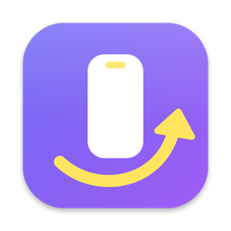
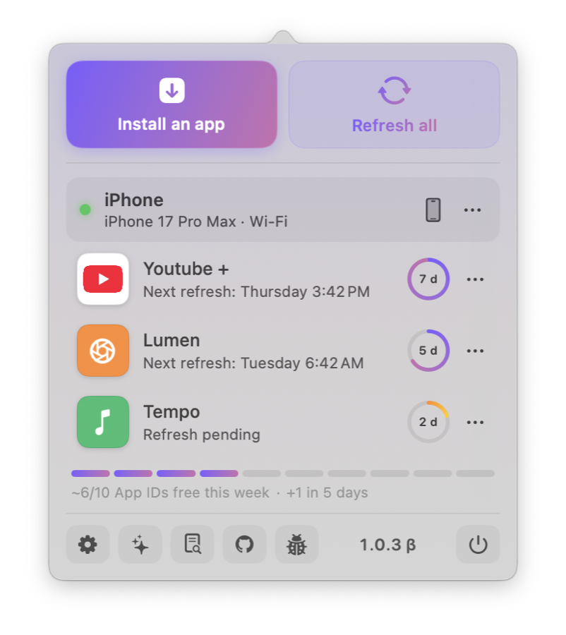
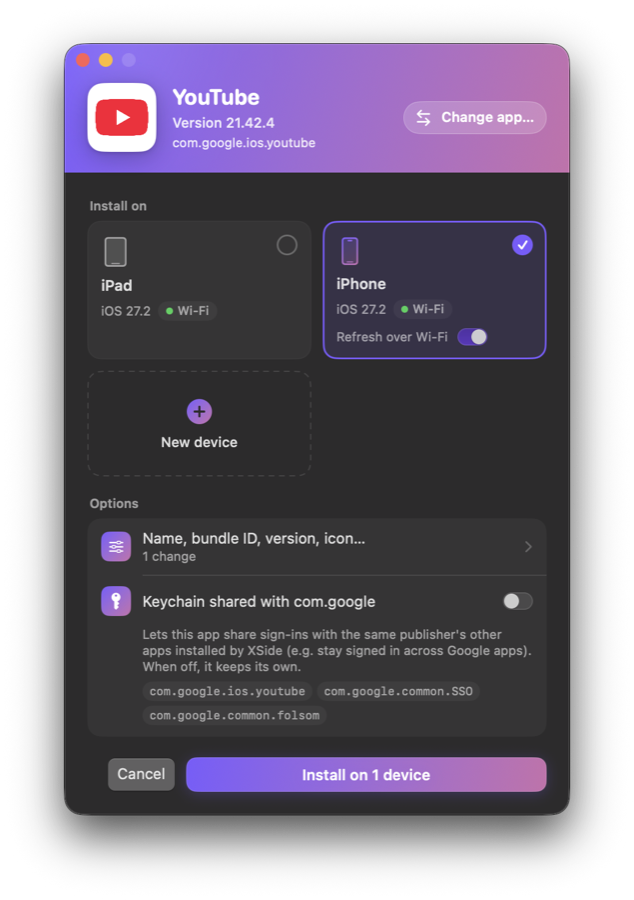
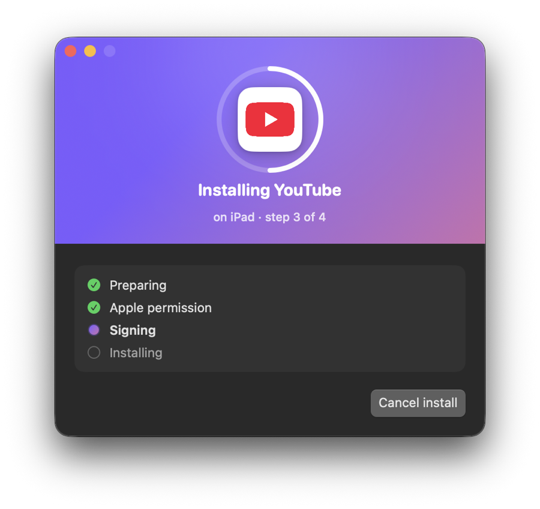
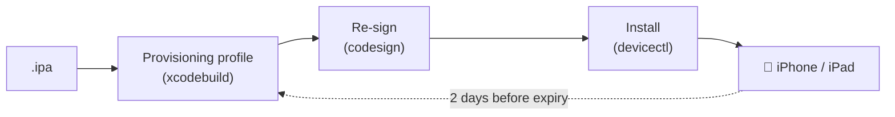

<div align="center">



# XSide

**Sideload iOS apps from your Mac's menu bar, and never let them expire.**

Free Apple Account · Xcode's own tools · Auto-refresh over USB or Wi-Fi

[](#-requirements)
[](https://swift.org)
[](https://developer.apple.com/xcode/)
[](LICENSE)
[](https://github.com/Antholife/xside/releases)
[](#-apples-limits-with-a-free-account)

**English** · [Français](README.fr.md)

</div>

---

XSide installs `.ipa` files on your iPhone and iPad with a free Apple Account, then re-signs and reinstalls them before Apple's 7-day expiry, quietly, from the menu bar.

> [!WARNING]
> **XSide is in beta.** This is a pre-release: some bugs may still show up (though it's been holding up well so far), and not every planned feature is in yet. Found something odd? [Open an issue](https://github.com/Antholife/xside/issues).

> [!NOTE]
> XSide never asks for your Apple password. Signing goes through the account you already added in Xcode, using Xcode's own tools: `xcodebuild`, `codesign` and `devicectl`.

<p align="center">
  <picture>
    <source media="(prefers-color-scheme: dark)" srcset="docs/assets/screenshots/panel-dark.png">
    
  </picture>
</p>

<p align="center">
  
  
</p>

## ✨ Features

| | |
|---|---|
| 📥 **Drop to install** | Drop an `.ipa` onto the menu-bar icon, or pick one, and install it on one or several devices. |
| ✅ **Checks before installing** | An iOS too old for the app, a device already holding its 3 apps (uninstall one right there), no App ID left: you know before. |
| 🔄 **Auto-refresh** | Apps are refreshed 2 days before they expire, over USB or Wi-Fi (your choice, per device), or all at once with *Refresh all*. |
| 🔔 **Never miss an expiry** | Reminders, a badge on the menu-bar icon, and notifications with *Refresh now* and *Open XSide* buttons. |
| 📱 **At a glance** | A panel under the menu-bar icon: each app's own icon, its devices, the days left, and the week's App IDs as a strip. |
| 📊 **Real progress** | Percentages while signing, time spent while sending to the device, and the percentage on the Dock icon. |
| 🎛️ **Per-app controls** | Refresh now, pause refreshing, or uninstall from the device. |
| ⬆️ **Updates itself** | New versions arrive automatically (Sparkle, signed); choose how often and the channel. |
| 🧭 **Guided setup** | A first-launch walkthrough: Xcode, Apple Account, signing certificate, notifications, devices. |
| 🐞 **Easy bug reports** | Logs with your personal details masked, exported in one click, and a bug button in the panel. |
| 🌍 **Localized** | English and French. |

## ⚙️ How it works



## 📋 Requirements

- A Mac with **macOS 15 or later**.
- **Xcode**, installed in `/Applications` and opened once.
- An **Apple Account** added in *Xcode > Settings > Apple Accounts*. A free account is enough.
- **Developer Mode** enabled on the device, and the device paired with the Mac once over USB.

> [!TIP]
> If your iPhone runs an iOS beta, you need the matching Xcode beta, from [developer.apple.com/download/applications](https://developer.apple.com/download/applications/).

Windows and Linux aren't supported: XSide relies on Xcode, which only runs on macOS.

## 🍎 Apple's limits with a free account

| Limit | What it means |
|---|---|
| ⏳ **7 days** | Apps expire after a week. XSide refreshes them before that, as long as it keeps running in the menu bar. |
| 📱 **3 apps** | At most 3 sideloaded apps per device. |
| 🆔 **10 App IDs / 7 days** | XSide shows an estimate of what's left: Apple doesn't expose the real count. |
| 🧩 **No extensions** | Widgets, share extensions and Watch apps are removed before signing. |

## 🚀 Install

1. Download `XSide-<version>.zip` from the [latest release](https://github.com/Antholife/xside/releases).
2. Unzip it, move `XSide.app` to `/Applications` and open it.

Runs on Apple silicon and Intel Macs. To build it yourself instead:

```sh
git clone https://github.com/Antholife/xside.git
cd xside
scripts/bundle.sh   # builds build/XSide.app
```

> [!IMPORTANT]
> The app isn't notarized. If macOS blocks it, go to **System Settings > Privacy & Security** and click **Open Anyway**.

Keep XSide running in the menu bar (turn on *Launch at login* in its settings): that's what refreshes your apps. XSide then updates itself (Sparkle), from *Settings > Updates*.

## 🛠️ Development

```sh
swift build                      # build
swift test                       # core logic tests (Sources/XSideCore)
CONFIG=debug scripts/bundle.sh   # build/XSide-debug.app, a separate app with its own data
scripts/check-strings.sh         # English and French strings match
```

## 📝 Changelog

See [CHANGELOG.md](CHANGELOG.md) for what changed in each version.

## 📄 License

[MIT](LICENSE) · Made by [Antholife](https://github.com/Antholife)
